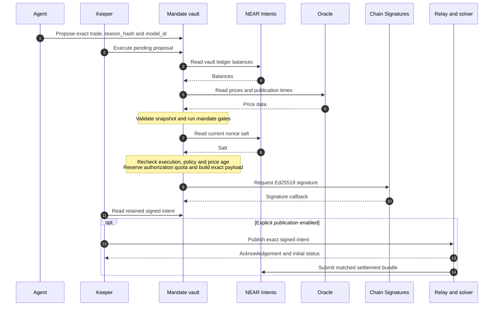

<p align="center">
  <picture>
    <source media="(prefers-color-scheme: dark)" srcset="web/assets/logo-light.svg">
    
  </picture>
</p>

# Mandate

**An on-chain authorization boundary between a trading agent and treasury funds on NEAR Intents.**

Mandate is a Rust smart-contract vault that checks an exact trade against an
owner-defined policy before requesting an Ed25519 signature from NEAR Chain
Signatures. Treasury balances live in the vault account's ledger inside the
configured NEAR Intents contract. The reference agent proposes decisions; it
has no treasury signing key. A separate owner controls rules, pausing, agent
assignment and delayed withdrawals.

The agent can use a manual plan, a deterministic two-asset rebalancer or an
optional model response. Each proposal remains subject to the same on-chain
rules. A compromised agent can still make harmful trades within those rules:
Mandate limits authorization, rather than guaranteeing profitable decisions.

> **Experimental prototype — not ready for real funds.** Local contract and
> client tests, sandbox fixtures and historical interoperability experiments
> exist. The full sandbox integration suite passed locally on commit `aa32116`,
> including the gas tests. That is not CI on that commit, not a final release
> artifact. Gas measurements from the 7 November run are in `docs/evidence/gas.txt`. Live vault signing,
> funded settlement and live withdrawal/recovery evidence remain open.
> The project has not received an independent professional audit.
> Start with [Security](SECURITY.md), [Threat model](THREAT_MODEL.md) and
> [Operational readiness](docs/OPERATIONAL-READINESS.md).

[Website](https://mandatenear.xyz/) ·
[Architecture](docs/ARCHITECTURE.md) ·
[Agent usage](agent/examples/README.md) ·
[Keeper usage](keeper/examples/README.md) ·
[Recorded evidence](docs/evidence/)

## Contents

- [Architecture and trade flow](#architecture-and-trade-flow)
- [Local quickstart](#local-quickstart)
- [Mandate rules and units](#mandate-rules-and-units)
- [Authority and trust boundaries](#authority-and-trust-boundaries)
- [Contract API](#contract-api)
- [Agent modes and model provenance](#agent-modes-and-model-provenance)
- [Keeper and relay publication](#keeper-and-relay-publication)
- [Withdrawals and recovery](#withdrawals-and-recovery)
- [Deployment and migration](#deployment-and-migration)
- [Verification and evidence](#verification-and-evidence)
- [Website and dashboard](#website-and-dashboard)
- [Remaining release work](#remaining-release-work)
- [Repository map](#repository-map)
- [Project history and license](#project-history-and-license)

## Architecture and trade flow

The vault separates **decision making** from **spending authority**. Its pure
[policy engine](contracts/vault/src/engine.rs) also powers client previews, but
only the contract's execution result authorizes a signature. Client snapshots
cannot replace the contract's balance, oracle, timing and policy checks.



This diagram describes the successful path. Failed reads, rejected gates,
expired execution windows or obsolete callbacks cannot authorize a new
signature. Before requesting signing, the vault reserves the approved
turnover, cooldown, high-water mark and signed-intent deadline. Failed signing
or an unfilled intent does not refund those reservations automatically.

The signature binds the exact `raw_ed25519` intent payload, verifier, token
amounts, deadline and salt-bound V1 expirable nonce. The Chain Signatures
request uses path `intents`, `payload_v2` with `Eddsa`, and domain `1`. The vault
checks the returned Ed25519 scheme and signature length; NEAR Intents performs
cryptographic verification and settlement validation.

**A signature, relay acknowledgement or relay-reported status is not proof of
funded settlement.** Settlement evidence requires final transaction/receipt
results and the corresponding ledger changes.

## Local quickstart

### Prerequisites

| Tool | Version / purpose |
|---|---|
| Rust / rustup | Rust **1.95.0**, pinned in [rust-toolchain.toml](rust-toolchain.toml), with rustfmt, Clippy and `wasm32-unknown-unknown` |
| Node.js | **22 or later** for the site/dashboard JavaScript tests |
| Python | **3** for reference checks, inspection tests and the local preview |
| cargo-near | **0.22.0**, used by the [CI workflow](.github/workflows/ci.yml) for contract/sandbox work |
| NEAR test stack | near-sdk **5.30.0**, near-api **0.8.7**, near-sandbox **0.4.0**; see [Cargo.toml](Cargo.toml) |

The first run may download toolchains and Rust dependencies. Sandbox tests also
need a local sandbox binary and permission to bind loopback ports. These checks
use local fixtures and test identities; no live wallet or model-provider
configuration is needed.

```sh
git clone https://github.com/moltaphet/mandate-near.git
cd mandate-near
./scripts/verify.sh
```

The fast command runs formatting, strict Clippy, local documentation references,
site/dashboard logic, shared-reader parity, deployment-inspector tests,
workspace library tests and the agent's autonomous/model/protocol/provenance
suites. It exits at the first failure. `All checks passed.` means this selected
fast scope passed, not that live operation or sandbox integration passed.

For the complete configured sandbox scope:

```sh
./scripts/verify.sh --integration
```

This repeats the fast checks, then builds/deploys contracts **inside a local
NEAR sandbox**, using the supplied Intents fixture and stand-in signer/oracle.
It does not deploy to testnet or mainnet.

### Preview the existing site locally

```sh
python3 -B scripts/dashboard-fixture.py
```

Open [http://127.0.0.1:8124](http://127.0.0.1:8124) and select **Local test vault**.
The server exposes whitelisted web assets and fixed synthetic RPC responses;
it demonstrates the interface, not an actual vault deployment. Stop it with
Ctrl+C. A host that forbids loopback binding cannot run this preview or the
local HTTP protocol fixtures.

## Mandate rules and units

A [Mandate](contracts/vault/src/mandate.rs) defines the complete trading policy.
Its configuration is validated at initialization and on every rule change.

| Field | Meaning and enforced bounds |
|---|---|
| `assets` | **1–20** unique `nep141:<AccountId>` assets; each has token decimals **0–30** and a price-feed identifier |
| `stable_assets` | Nonempty, unique subset of allowed assets designated by the owner for de-risking |
| `max_trade_usd` | Positive per-trade input notional; must not exceed the daily authorization limit |
| `max_daily_turnover_usd` | Maximum reserved input notional in a **UTC calendar day**, resetting at 00:00 UTC |
| `max_position_bps` | **1–10,000 bps**; projected non-stable exposure cap, with checks allowing de-risking of existing excessive positions |
| `max_slippage_bps` | **1–500 bps**; minimum output relative to oracle value, with a hard ceiling of **5%** |
| `max_drawdown_bps` | **1–10,000 bps**; below the high-water threshold, only trades into declared stable assets are allowed |
| `min_trade_interval_sec` | Minimum interval between recorded approval timestamps, in whole seconds |
| `max_price_age_sec` | **1–300 seconds**; price-age equality passes, and up to **5 seconds** of future timestamp skew is accepted |
| `allowed_model_ids` | **0–8** unique, nonblank declared source IDs, at most **64 UTF-8 bytes** each; empty denies all proposals |

Amounts use integer units throughout:

- USD configuration fields are JSON decimal **strings** (`U64`) in microUSD:
  **$1 = 1,000,000**, so a $50 trade limit is `"50000000"`.
- Token amounts are JSON decimal **strings** (`U128`) in token base units:
  1 token with 6 decimals is `"1000000"`; with 24 decimals it is
  `"1000000000000000000000000"`.
- **100 bps = 1%**. Token decimals and feed units must match the reviewed assets.

[Math](contracts/vault/src/math.rs) uses checked 256-bit intermediates and
conservative rounding: input exposure rounds up and output valuations round
down. The engine checks asset validity, cooldown/signed-intent timing, coherent
fresh prices for traded or held assets, sufficient balance, trade size, daily
quota, slippage, drawdown and projected position share.

These checks have specific limits. Staleness and Pyth confidence guards do not
prove market correctness or a stablecoin peg. The drawdown rule runs when a
trade is evaluated; it does not continuously monitor NAV or automatically sell
positions. Projected position checks do not guarantee realized weights after
price changes, external credits or excess output. Daily turnover measures
**authorized oracle notional**, not successful fills or a rolling 24-hour sum.

### Timing and delayed changes

| Event | Boundary |
|---|---|
| Proposal lifetime | **60 seconds**; execution requires chain time strictly before expiry |
| Signed intent lifetime | **120 seconds from approval**; callback delay reduces the usable lifetime |
| SR-1 signing window | **300 seconds from execution start** |
| Unresolved signing lock | Expires at execution start + **420 seconds** (300 + 120); completion or pre-sign failure may release it earlier |
| Mandate loosening / source admission | **86,400 seconds** |
| Agent replacement | **86,400 seconds**; first assignment is immediate |
| Withdrawal request | **86,400 seconds** before dispatch |
| Withdrawal recovery eligibility | **300 seconds** after the attempt starts |

Time comes from NEAR block timestamps floored to whole Unix seconds. Delayed
changes apply at `now >= effective_sec`. A replacement queued rule change,
agent change or withdrawal receives a new 24-hour deadline. A safe withdrawal
retry preserves the original request's maturity but requires owner rearming.

Any mandate change that loosens a control is delayed; pure tightening applies
immediately and clears the old queued change. Adding a declared source is
loosening, including the first ID added to an empty list. Removing a source
applies immediately. Membership is exact and case-sensitive, with no trimming
or normalization of accepted IDs.

## Authority and trust boundaries

| Actor | Authorized role | Boundary |
|---|---|---|
| Owner | Set/cancel rules and agent changes, pause/unpause, authorize/cancel withdrawals and safe retries | Sensitive calls check the **predecessor account** and require exactly **1 yoctoNEAR**; loosening and withdrawals are delayed |
| Agent | Submit exact proposals under an admitted source ID | Cannot change policy, withdraw or directly request treasury signatures through the vault |
| Keeper / any caller | Trigger eligible execution, registration, delayed applies and recovery | Cannot replace owner-authorized parameters or the vault-built signed payload |
| Solver / relay | Quote, relay and match signed intents | External availability and final settlement must be established independently |
| Vault account operator | Controls any remaining account-level permissions | Bypass-capable permissions must be eliminated in the reviewed deployment; initialization does not remove them |
| Intents, signer and oracle operators | Provide external custody, signatures and prices | Their deployed binaries, administrative roles and behavior remain explicit trust dependencies |

`pause` needs owner authorization but no attached deposit, allowing a restricted
owner function-call authorization to stop unsigned work quickly. `unpause` and
`resume_proposals` require owner authorization plus 1 yoctoNEAR. Pausing cannot
revoke an already-issued signature; its deadline and Intents verification still
apply.

A declared `model_id` and a 64-hex `reason_hash` authenticate no model by
themselves. The contract admits labels and commits to data. Provider-origin
verification is a separate client-side operation described below.

## Contract API

See [lib.rs](contracts/vault/src/lib.rs) for full JSON types and callback wiring.
Private callbacks are internal receipt handlers, not operator commands.

| Operation | Methods | Caller / deposit |
|---|---|---|
| Initialize | `new`, `new_with_externals`, `new_with_oracle` | One-time deployment initialization; use the reviewed external accounts and provider |
| Admit/change policy | `set_mandate`, `cancel_pending_mandate` | Owner; exactly 1 yoctoNEAR |
| Preview/apply policy | `simulate_mandate_change`, `apply_pending_mandate` | Read-only preview / permissionless matured apply; no deposit |
| Agent assignment | `set_agent`, `cancel_pending_agent` | Owner; exactly 1 yoctoNEAR |
| Apply agent change | `apply_pending_agent` | Permissionless after maturity; no deposit |
| Register signing authority | `register_intents_key` | Permissionless; no caller deposit; vault pays the external registration deposit |
| Propose / execute | `propose`, `execute` | Configured agent / permissionless executor; no deposit |
| Stop / resume | `pause`, `unpause`, `resume_proposals` | Owner; no deposit for pause, exactly 1 yoctoNEAR for either resume method |
| Authorize withdrawal | `request_withdrawal`, `cancel_pending_withdrawal`, `rearm_pending_withdrawal` | Owner; exactly 1 yoctoNEAR |
| Dispatch / recover | `apply_pending_withdrawal`, `recover_withdrawal` | Permissionless when protocol conditions pass; no deposit; gas requirements below |
| Migrate | `migrate` | Private vault self-call in an authorized upgrade; supported layouts and strict preconditions only |

The proposal interface is:

```text
propose(asset_in, asset_out, amount_in, min_amount_out, reason_hash, model_id) -> proposal ID
```

Useful public reads include `get_owner`, `get_agent`, `get_mandate`,
`get_externals`, `get_oracle_kind`, `get_trading_state`, `get_chain_time_sec`,
`is_paused`, `is_halted`, `get_strikes`, `is_in_flight`, `is_key_registered`,
`get_pending_proposal`, `get_signed_intent` and `get_last_proposal_outcome`.
Queued owner changes and withdrawal stages have dedicated views. Reading an
old retained signature or outcome does not make it current or settled.

## Agent modes and model provenance

The [reference agent](agent/) keeps strategy outside the treasury authority.
Executing modes use the agent's NEAR account to submit proposals, not to sign
Intents treasury payloads.

| Mode | Invocation after `cargo run -p mandate-agent --` | Behavior |
|---|---|---|
| Manual | `public-plan.json` | Validates a plan and submits it with source `manual-v1` |
| Autonomous preview | `--auto agent/examples/rebalance-public.json --dry-run` | Public RPC/quote requests; no signing configuration, proposal or outbox |
| Autonomous execution | `--auto public-config.json` | Prepares and submits one two-asset rebalance decision with source `rebalance-v1` |
| Autonomous loop | `--auto public-config.json --loop` | Repeats, waiting 30 seconds after each completed decision; errors may terminate the process |
| Model preview | `--model --dry-run` | Calls the configured model provider; no NEAR transaction or outbox |
| Model execution | `--model` | Validates a response, refreshes state, writes public evidence and submits the exact decision |
| Offline record verification | `--verify-model public-record.json --reason-hash REPLACE_WITH_ON_CHAIN_HASH` | Checks canonical commitment, decision and supplied/stored signatures; no chain calls |

The autonomous example is a **template**, not an approved deployment. Replace
its example vault/assets and network expectations with reviewed values. The
strategy supports exactly two mandate assets, trades toward the configured
target outside its band, requests a matching exact-input quote and previews the
shared engine. A second final-block snapshot repeats readiness and gate checks
before submission. On-chain execution resolves any subsequent race.

Quotes must outlive the configured validity threshold, whose minimum is
450 seconds. The documented relay requires partner authentication; an
unauthenticated preview can fail. See [public configuration](agent/examples/README.md).

### Model configuration and strict decision schema

Model mode requires runtime `NEAR_RPC_URL`, `VAULT_ID`, `MODEL_ENDPOINT_URL`,
`MODEL_NAME` and `MODEL_API_KEY`; `NEAR_CHAIN_ID` is an optional network pin.
The endpoint is the complete HTTPS chat-completions URL. There is no fallback
provider or model. Executing modes additionally need runtime `AGENT_ACCOUNT`,
`AGENT_SECRET_KEY` and `AGENT_OUTBOX`. These identify/sign for the agent account,
not the treasury. Keep authentication outside public configuration/evidence files.

The provider returns an OpenAI-compatible completion envelope. Its assistant
message content must be a JSON object with **exactly these seven fields**:

| Field | Accepted value |
|---|---|
| `asset_in`, `asset_out` | Distinct assets in the mandate |
| `amount_in`, `min_amount_out` | Positive canonical decimal `u128` strings in token base units |
| `rationale` | Nonblank, 1–800 Unicode characters |
| `no_trade` | Boolean |
| `no_trade_reason` | Required field; string or null |

All fields remain required and valid even when `no_trade` is true. Unknown
fields, malformed responses, invalid amounts/assets, closed controls, timeouts
and failed gate previews yield no proposal. The client never repairs amounts or
changes policy from rationale text. The response's model name must exactly
match configured `MODEL_NAME`, and that source must be admitted by the vault.
Reserved `manual-v1` and `rebalance-v1` cannot be used as model configuration.

### Canonical commitments and signature verification

Model `reason_hash` is SHA-256 of the canonical response envelope using
`mandate-response-json-v1`, defined in [Architecture](docs/ARCHITECTURE.md).
Raw request/response SHA-256 values remain separate. Manual and rebalancer
modes retain their rationale hashes.

A supplied invalid or unsupported signature blocks proposal submission.
Supported NEAR EIP-191 proofs are verified against an independently configured
public signer pin. Optional settings are `MODEL_SIGNATURE_URL`,
`MODEL_SIGNING_ADDRESS` and `MODEL_SIGNATURE_REQUIRED`:

- The lookup URL must be an absolute HTTPS base ending in `/`, on the same
  origin as the completion endpoint; the client appends the encoded response ID.
- `MODEL_SIGNATURE_REQUIRED=true` requires lookup and signer configuration
  before inference. Any configured lookup/verification failure produces no trade.
- Unset/`false` permits generic unsigned mode when no proof lookup or signature
  is supplied. Its provenance remains **UNVERIFIED**.

Completion and proof lookup share a 20-second deadline; each response body is
limited to 64 KiB. Before a model proposal, the client writes a bounded public
record containing the exact request/response bodies, hashes, decision, declared
IDs and proof. Records are limited to one MiB. Public inference/evidence is not
a privacy guarantee.

To verify a **generated ModelRecord**, replace the uppercase placeholders:

```sh
cargo run -p mandate-agent -- --verify-model PUBLIC_RECORD.json --reason-hash ON_CHAIN_REASON_HASH
```

Signed records additionally require `--signing-address PUBLIC_SIGNER_ADDRESS`;
stored signatures cannot be skipped. `--signature PUBLIC_PROOF.json` verifies
an additional proof, and `--plan PUBLIC_PLAN.json` compares the exact decision.
A matching hash or pinned signature proves neither authentic chain state,
on-chain approval, model execution, TEE attestation, privacy nor settlement.
Live provider compatibility remains unverified; tests use fake clients.

## Keeper and relay publication

The [keeper](keeper/) pays for permissionless `execute` calls and writes signed
intent handoff files to `KEEPER_OUTBOX`. Default mode makes no relay publication
requests. Runtime settings are `NEAR_RPC_URL`, `VAULT_ID`, `KEEPER_ACCOUNT`,
`KEEPER_SECRET_KEY` and `KEEPER_OUTBOX`. Keep signing material outside public
configuration and evidence.

Explicit publication is enabled with:

```sh
cargo run -p mandate-keeper -- --publish keeper/examples/relay-public.json
```

Configure the reviewed network and point `metadata_dir` at the agent's public
proposal outbox. Runtime `RELAY_AUTH` may supply relay authentication; never put
it in the public JSON. This command may pay for execution and publish an intent;
it is not an offline preview.

Publication requires matching proposal/quote metadata and a final-block check
of the current signed result, vault/verifier identity, exact input/output,
signature format and deadlines. Retry uses bounded backoff and preserves the
same signed nonce. The keeper records acknowledgement and an initial relay
status separately; even relay-reported `SETTLED` retains
`settlement_verified: false`. Continuous status monitoring and independent final
receipt/ledger verification are not implemented. See [Keeper usage](keeper/examples/README.md)
and the [Message Bus protocol](https://docs.near-intents.org/integration/market-makers/message-bus/rpc).

## Withdrawals and recovery

Withdrawals move supported NEP141 assets from the vault's Intents ledger through
Intents `ft_withdraw`. The receiver cannot be the vault or configured Intents
account. A queue request fixes asset, amount and receiver and starts a 24-hour
delay; replacing it restarts that delay. Queuing/dispatching is refused while a
trade execution or unexpired signed intent owns the relevant lock.

The current `unique_voucher_v1` protocol separates authorization, dispatch and
recovery:

1. **Owner queues one request**, with exactly 1 yoctoNEAR, arming one attempt.
   After maturity, `apply_pending_withdrawal` requires at least **280 TGas**.
2. **Preparing:** the vault consumes the armed attempt and records a never-reused
   ID before issuing its one-unit voucher and reading the asset balance.
   Authenticated Intents reads must show global `mt_supply` exactly one,
   source balance one, both recovery sinks zero and sufficient asset balance.
3. **Dispatched:** a batch moves the voucher to `s.<vault>` before calling
   `ft_withdraw`. A full-amount final response records `Delivered`; an explicit
   zero/refund may safely requeue only the still-authorized request. An ambiguous
   or partial result retains the unresolved guard.
4. **Recovery:** after 300 seconds, a Preparing attempt can be invalidated
   before dispatch. Dispatched recovery requires at least **140 TGas** and races
   its voucher to `c.<vault>`. Authenticated supply/source/destination proof
   determines whether cancellation or the initial debit occurred.
5. **Safe retry:** every requeue is unarmed. Only the owner with exactly
   1 yoctoNEAR can call `rearm_pending_withdrawal`; it preserves maturity and
   the next attempt uses a new ID. Recovery never blindly repeats an unknown
   transfer amount.

Recovery proof `sent=0, cancelled=1` permits safe requeue. Proof
`sent=1, cancelled=0` records `DebitObserved` and consumes authorization.
**DebitObserved is not terminal receiver delivery** and does not exclude a
later FT refund; resolver/refund receipts may overlap subsequent operations.

**Accepted availability residual (F26):** missing, failed or inconsistent proof
retains the guard, blocking new **withdrawal dispatches and trade authorization**.
A successor withdrawal request can still be queued. Neither elapsed time,
owner authority nor a larger balance overrides the guard. The original
withdrawal may already have moved funds. This residual is accepted for the
current testnet scope; it does not establish real-fund readiness.

Read `get_withdrawal_status`, `get_last_withdrawal_outcome`,
`get_pending_withdrawal`, `get_withdrawal_stage`, `is_withdrawal_retry_armed`,
`get_withdrawal_protocol` and `get_withdrawal_recovery_accounts` for bounded
status. Full prerequisites and proof limitations are in
[Operational readiness](docs/OPERATIONAL-READINESS.md).

SR-1 trade recovery is separate: every error after dispatching a signing request
retains the timed execution lock because a signature might already exist.
Pre-sign read/validation failures can release it safely. Execution IDs and
configuration revisions prevent obsolete callbacks from changing a newer
execution. There is no public owner reset that discards a trade lock early.

## Deployment and migration

The intended owner is a **DAO/multisig distinct from the vault**. Its final
public account and governance/recovery procedures remain pending. **The oracle is
not yet selected.** Pyth Core no longer supports NEAR: its documentation lists NEAR
among chains whose contracts were removed, and no NEAR address appears on the Pyth
Pro contract page. The price-oracle adapter needs its own testnet verification of
feeds, units and an updater. Adapter implementation alone does not establish live
prices.

`new` and `new_with_externals` retain the PriceOracle adapter;
`new_with_oracle` can select `price_oracle` or `pyth` at initialization.
The adapter is immutable afterward. Pyth uses batch reads and validates feed
format, price, exponent, publication time and confidence against the existing
slippage allowance. Both adapters use the same engine and signing-age guard.

Before funding a deployment, establish:

- A fresh vault account, at most **62 bytes** long, deployed/initialized atomically
  without added access authority; a distinct, recoverable owner.
- Reviewed Intents/signer/oracle binaries, external administrative roles,
  registered derived signing authority and adequate storage funding.
- No bypass-capable vault account permissions. The contract does not remove
  those permissions itself.
- Absent `s.<vault>` and `c.<vault>` accounts with no Intents signing/proxy
  authority and no later account-creation path.
- No prior issuance of future canonical withdrawal vouchers and no outstanding
  mint/burn/resolver/refund receipts that could invalidate uniqueness. Current
  supply or permission counts cannot prove that history; prefer a fresh account.

The historical `mandate-r1-4715a0.testnet` account is a signing experiment,
**not a verified current vault**. Do not reuse example account names as deploy
instructions. The [testnet operation plan](docs/superpowers/plans/2026-11-07-testnet-run-plan.md)
keeps the new vault, owner and agent identities pending and requires separate
approval for funded/deployment actions.

### Supported migrations

Changing WASM alone cannot safely read an incompatible Borsh state layout.
Private `migrate` supports exactly five historical layouts: pre-sequence
`77ebc0c`, sequence-enabled `0de5c48`, pre-provider remediation,
provider-enabled pre-voucher, and voucher-enabled pre-model `b43569d`.
It preserves the chosen provider where present.

Migration requires a paused, quiescent vault with a distinct owner: no stored
execution, pending proposal, queued withdrawal, future signed deadline or
unresolved withdrawal guard/stage/retry authorization. Active and queued old
mandates receive **empty source lists**; admitting any source requires a new
24-hour change, while existing queued change deadlines are preserved.

Migration is an authorized self-call during upgrade, not an owner recovery
escape or an upgrade mechanism for an already sealed account. Unknown external
receipt history remains unresolved by migration. See
[migration.rs](contracts/vault/src/migration.rs) and
[deployment prerequisites](docs/OPERATIONAL-READINESS.md#deployment-and-migration).

## Verification and evidence

Evidence is scoped to its recorded source/artifact, environment and date.
Historical results are not a current release certificate.

| Evidence | What it establishes | Remaining limit |
|---|---|---|
| [Captured fast run, 7 November](docs/evidence/phase0-9-2026-11-07/final-fast-outside-sandbox-after-model-name-fix.txt) | Saved output ends `All checks passed.` after the model-name correction | Log lacks an embedded revision/time header; final release verification must be tied to an immutable artifact |
| [Verification script](scripts/verify.sh) and [CI](.github/workflows/ci.yml) | Defined fast scope plus 14 configured sandbox targets in integration mode | A workflow definition is not a passing CI result. The integration suite passed locally on `aa32116`; CI on that commit and the final release artifact remain unverified |
| [Eight attack receipts](docs/evidence/attacks.txt) | Historical sandbox refusals recorded on **6 November 2026** | Not a claim that every attack or the final revision passed |
| [Gas limit evidence](docs/evidence/gas-limit.txt) | Historical **4 November** size measurements motivated the 20-asset cap | Superseded for final-source numbers by [`docs/evidence/gas.txt`](docs/evidence/gas.txt): a 7 November run (exit 0) that includes the maximum-assets, source-ID case. It is not a final artifact or CI result |
| [R1 report](docs/spikes/R1.md) | Historical separate spike → testnet MPC → mainnet simulation interoperability | Not a funded trade from the current vault or verified current deployment identity |
| [Sandbox settlement test](contracts/vault/tests/settlement.rs) | Test for matched funded settlement, atomic refusal and nonce replay against supplied Intents fixture | Uses a stand-in signer/oracle, not live MPC or authenticated current mainnet binaries |

Earlier restricted-host attempts failed because protocol fixtures could not
bind loopback ports. A later captured fast run passed outside that restriction;
neither result substitutes for final sandbox/gas or live evidence. There is no
fixed cumulative test-count claim here: use the output of the actual run.

Focused local commands:

```sh
cargo test -p mandate-vault --lib engine::
cargo test -p mandate-vault --lib property_generator_covers_approvals_and_rejections -- --nocapture
./scripts/check-claims.sh
```

`check-claims.sh` checks cited local names/paths, not claim truth or external
links. `attack-demo.sh` and `gas-report.sh` run sandbox scenarios and write
tracked evidence; rerun them only when intentionally refreshing that evidence.
Final gas/storage measurements must identify the exact build and adapter.

## Website and dashboard

The [Mandate website](https://mandatenear.xyz/) has an integrated read-only vault
inspection section. [web/site/index.html](web/site/index.html) is the main page;
[web/dashboard/index.html](web/dashboard/index.html) is the dedicated dashboard.
They do not submit wallet transactions or provide owner-control execution.

Inspection reads public controls, adapter, pending changes, withdrawal stages
and listed Intents balances at one final-block anchor. Loading/errors, observed
state, synthetic sample mode and historical attack replay are distinct. Public
RPC observations do not independently authenticate custody, external upgrade
roles or terminal settlement. Published-source correspondence must be checked
for each website release.

The tested reader is shared with the site through [build-web.py](scripts/build-web.py).
Serve the page over HTTP; direct local file opening cannot reliably load its
browser modules. Use the fixture quickstart above for a deterministic preview.

## Remaining release work

Complete the funded core flow before treating optional integrations as ready:

1. **Freeze and independently review the release.** Tie source, allowed-file
   manifest, reproducible build, artifact hash, full integration and maximum-size
   gas/storage evidence together; review the recent source-admission and recovery changes.
2. **Verify custody prerequisites.** Confirm fresh vault/owner/agent accounts,
   DAO execution/cancellation/recovery, usable oracle feeds/updater, external
   deployed code and administrative roles, voucher history and sealed permissions.
3. **Run the approved live signing and settlement path.** Register the derived
   authority, obtain an actual vault MPC signature, settle a small matched trade
   and record receipt/ledger evidence plus replay refusal.
4. **Prove delayed withdrawal and recovery on the intended chain.** Wait a real
   86,400 seconds; demonstrate delivery, failed/ambiguous responses, cancellation
   races and late callbacks. Patching sandbox maturity proves no elapsed-day claim.
5. **Demonstrate the agent and explicit keeper relay path.** Record exact quote,
   proposal, signature and final settlement; add operational handling for stale
   feeds, unresolved guards and unpublished intents.
6. **Validate optional provider/TEE features separately.** Live pinned-signature
   compatibility, authenticated model execution, private inference and OutLayer
   deployment remain open; generic model mode is already explicitly unverified.
No current evidence establishes profitable strategy, private model execution,
a live attack dashboard or safe real-fund operation.

## Repository map

| Path | Purpose |
|---|---|
| [contracts/vault/src/](contracts/vault/src/) | Vault entry points, policy validation, pure engine, integer math, intent builder, migrations and withdrawal protocol |
| [contracts/vault/tests/](contracts/vault/tests/) | Owner controls, signing/registration, agent/keeper/model paths, attacks, settlement, recovery, Pyth, sealed deployment and gas tests |
| [contracts/mock-ft/](contracts/mock-ft/) | Test-only NEP141 token |
| [contracts/mock-oracle/](contracts/mock-oracle/) · [contracts/mock-externals/](contracts/mock-externals/) | Sandbox stand-ins; no live-provider guarantee |
| [agent/](agent/) | Manual/rebalance/model decisions, public snapshots, quote protocol, canonical evidence and provenance verification |
| [keeper/](keeper/) | Execution, signed-intent handoff and optional relay publication |
| [web/site/](web/site/) · [web/dashboard/](web/dashboard/) | Main site, integrated inspection and dedicated read-only dashboard |
| [scripts/](scripts/) | Verification, fixture preview, inspection and evidence tooling |
| [docs/ARCHITECTURE.md](docs/ARCHITECTURE.md) | Design, trust model and canonical-response format |
| [docs/PROJECT.md](docs/PROJECT.md) · [docs/TESTNET.md](docs/TESTNET.md) | Project scope and historical testnet record |
| [docs/OPERATIONAL-READINESS.md](docs/OPERATIONAL-READINESS.md) | Ordered release gates and deployment/recovery prerequisites |
| [docs/spikes/R1.md](docs/spikes/R1.md) · [docs/evidence/](docs/evidence/) | Historical interoperability report and captured test output |
| [SECURITY.md](SECURITY.md) · [THREAT_MODEL.md](THREAT_MODEL.md) | Reporting guidance, findings, assumptions and residual risks |

## Project history and license

Development began on **31 October 2026**. Development is AI-assisted, including
Claude Code and Codex, and uses vendored NEAR agent guidance. Dependencies and
versions are declared in the repository manifests; test mocks and external
fixtures do not establish production-provider identity.

Licensed under [MIT](LICENSE). Review the security and operational documents
before adapting the prototype for treasury custody.
